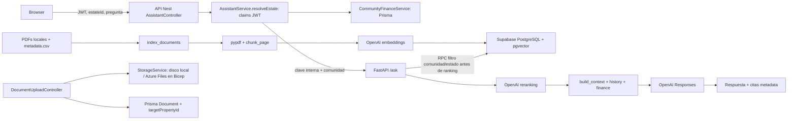

# RAG actual — auditoría previa a cambios

Fecha: 2026-10-13. Base: `bru_fincas`, commit `f7df326`. Este documento describe el código anterior a la refactorización, no recursos desplegados. No se leyeron secretos de `.env`, no se consultaron bases de datos ni se modificaron documentos reales.

Los dos flujos documentales NO tienen un puente automático. Subir un documento de la aplicación no lo introduce en el corpus RAG (`backend/src/files/files.controller.ts: DocumentUploadController.upload`, `rag/domora_rag.py: index_documents`).

## Inventario y 30 comprobaciones

| # | Tema | Evidencia y resultado |
|---|---|---|
| 1 | Arquitectura | Diagrama anterior; Python/FastAPI/OpenAI/Supabase en `rag/requirements.txt`, `domora_rag.py`; Nest/Prisma en `backend/src/assistant/assistant.module.ts`. No LangChain ni LlamaIndex en estas dependencias. |
| 2 | Subida | API app autenticada A/B, guard de finca y Multer 10 MB. Valida MIME declarado, no bytes. CLI RAG recorre PDFs; no endpoint upload RAG. `files.controller.ts`, `StorageService.assertAllowed`, `list_pdfs`. |
| 3 | Originales | RAG: PDFs en disco `--docs`, dos PDFs legales versionados en `rag/docs`. App: `StorageService` usa `STORAGE_DIR`, claves UUID bajo documents/estate. `infra/main.bicep` monta Azure Files; no Blob RAG. Ubicación real de producción: **NO DETERMINADO**. |
| 4 | Texto extraído | Solo contenido de chunks persistido, sin extracted.json ni page mapping independiente. `extract_pdf_pages`, `replace_chunks`. |
| 5 | Embeddings | `domora_rag_chunks.embedding extensions.vector(512)` en `rag/supabase_setup.sql`. |
| 6 | Vector store | PostgreSQL/pgvector accedido con cliente Supabase service role. `get_supabase`, `domora_hybrid_search`. Instancia efectiva: **NO DETERMINADO**. |
| 7 | Modelo embeddings | Default `text-embedding-3-large`, dimensión 512, configurables `DOMORA_EMBED_MODEL/DIMENSIONS`; `embed_chunks`, `embed_query`. Config real: **NO DETERMINADO**. |
| 8 | LLM | OpenAI Responses, `DOMORA_CHAT_MODEL` requerido, rerank configurable; `get_openai`, `call_text_model`. Modelo desplegado: **NO DETERMINADO**. |
| 9 | Chunking | Por página, párrafos/frases, 3200 caracteres + solape 450; `chunk_page`, `split_long_paragraph`. Extracción fallida de página se convierte en texto vacío. Sin OCR RAG. OCR de facturas en `backend/src/ai` es otro flujo. |
| 10 | Retrieval | RPC híbrida cosine/full-text/RRF, candidatos 12, reranking LLM y contexto final 5. `hybrid_search`, `rerank_results`, `answer_question`. SQL **filtra antes** del ranking: no se encontró vector search global seguido de postfiltro. |
| 11 | Permisos documentos | RAG solo comunidad/global y estado no excluido. App sí filtra Document.targetPropertyId por memberships linked/no revoked. `ResourcesService.listDocuments`, `DocumentUploadController.download`. No ACL por documento en RAG. |
| 12 | Identidad | Backend user_id=JWT.sub, role/estateIds/administratorId claims; RAG user_id añade channel. community_id se deriva/valida con claims; tenant_id/permissions RAG ausentes. `JwtStrategy.validate`, `AssistantService.resolveEstate/ragUserId`. Estate.administratorId es vínculo de gestora existente en Prisma. |
| 13 | Cliente | AskDTO permite question, estateId, channel, conversationId. ValidationPipe whitelist/forbid extras. No tenant ni rol en DTO. RAG directo AskRequest permite community_id/user_id a quien posea la clave interna. |
| 14 | Sesión | JWT firmado y expiración; no revalidación DB en JwtStrategy. Claims pueden sobrevivir una revocación hasta expiry (default 15 min `AuthService.issueTokens`). |
| 15 | Aislamiento | Filtro obligatorio comunidad chunks en SQL + global para todos. Sin tenant ni ACL, sin igualdad entre comunidad de documento/chunk. Publicación global por defecto para ruta desconocida en `detect_community_id`. Datos/ACL reales: **NO DETERMINADO**. |
| 16 | Filtros | `eligible` CTE en SQL precede rankings. Función SECURITY DEFINER con search_path fijo; execute solo service_role. RLS habilitado, sin políticas anon/auth. Credencial service_role común query/index; bypass RLS de esa credencial. |
| 17 | LLM autoriza | No. Backend/SQL deciden comunidad; modelo reranquea relevancia y redacción. No herramientas RAG ni SQL generado por modelo. |
| 18 | Datos al modelo | Reranker: candidatos hasta 2000 chars y metadata; final: pregunta, chunks relevantes, historia reciente y JSON finanzas agregado. `generate_answer`, `build_context`. Finanzas omiten detalle grupo 64 pero incluyen totales, permitiendo inferencia por resta; etiquetas de cuentas son texto libre. |
| 19 | Prompt | Responses.instructions separados de input; input concatena history/question/finance/FUENTES, devuelve JSON y se reconstruye footer determinista. `ANSWER_INSTRUCTIONS`, `generate_answer`, `append_sources_footer`. |
| 20 | Injection | Instrucciones explícitas para ignorar instrucciones documentales/historia; IDs de cita/artículos se contrastan con metadata. No garantía de inmunidad semántica; no ACL por documento que limite ese impacto. |
| 21 | Logs | No logs explícitos de prompts/chunks en flujo RAG inspeccionado. Mensajes completos sí se persisten como historial. Backend loguea error.message y ruta de fallo (puede incluir query identidad). Logs/telemetría externos: **NO DETERMINADO**. |
| 22 | Citas | `build_context` asigna S1.., document_id/title/filename/page/community/doc_type; artículos legales se buscan en chunks previos y se validan. No versión/sección persistida ni sources alias. |
| 23 | Borrado | CLI opt-in remove_missing elimina documentos no presentes en carpeta y cascada chunks, sin scope tenant, retención ni Blob. `remove_deleted_documents`. Historial sigue conservando respuestas/citas revocadas. |
| 24 | Actualización | Upsert metadata primero, DELETE chunks después, INSERT por lotes. No transacción completa; `upsert_document`, `replace_chunks`. Fallo deja versión parcial o scope antiguo. |
| 25 | Versiones | No document_id+version; relative_path único actúa como identidad. Sin activación atómica. |
| 26 | Duplicados | SHA256 + igualdad de metadata evita reprocesar misma ruta. Misma bytes/otra ruta crea otro documento. `sha256_file`, `metadata_equal`, `fetch_existing_document`. |
| 27 | Fallos | Excepciones abortan CLI; PDFs vacíos se omiten; extracción por página falla silenciosamente. No estado failed/quarantine durable, no malware scan ni staging. Zip chunks/embeddings sin comprobar longitudes en replace_chunks. |
| 28 | Secretos | `.env` RAG gitignored, _load_dotenv; OpenAI y Supabase service role variables. API key interna requerida >=32 caracteres al arrancar RAG. Backend la envía solo si configurada. Bicep parámetros secure/secrets CA, ACR/Azure Files con keys; sin MI ni Key Vault RAG. Valores efectivos: **NO DETERMINADO**. |
| 29 | Público | FastAPI expone /health, / y documentación por defecto; ask/history requieren clave interna. Host CLI configurable. Web debug no envía clave: no funciona contra API protegida. Bicep API external:false/frontend external:true, PG firewall Azure-services; no RAG desplegado por IaC. Red real: **NO DETERMINADO**. |
| 30 | Riesgos | JWT revocado; falta tenant/ACL; historial revocado; reasignación no atómica; fallback global; credencial admin compartida; ingest sin bytes/malware/Blob/retención; errores HTTP con str(exc); inferencia financiera; faltan pruebas multi-tenant. |

## Infraestructura, jobs y observabilidad

`infra/main.bicep` es el IaC vigente: Container Apps, Log Analytics, Azure Files y PostgreSQL Flexible Server 16 para la app. No template de RAG, VNet objetivo ni private DNS/endpoint RAG. `backend/docker-compose.yml` usa PostgreSQL 16 sin extensión vector, archivos locales y Nest; no worker RAG. `azure-pipelines.yml` y `.github/workflows/ci.yml` construyen/testean frontend/backend, no RAG. `backend/src/ai/ai-worker.service.ts` implementa jobs Prisma con leases para funciones AI distintas: no se observó cola de ingesta RAG. `rag/test_domora_rag.py` cubre redacción/citas; no aislamiento API/DB.

Logs actuales: Nest Logger y Log Analytics/alertas Azure en Bicep. No OTel RAG. Dependencias Python sin versiones fijadas. Despliegue, permisos efectivos, backups/soft delete, métricas reales, antivirus y contenido del índice: **NO DETERMINADO**.

## Revisión independiente

Revisor en contexto nuevo, solo lectura: confirmó los siete recorridos señalados (JWT revocado, falta ACL, historia revocada, scope antiguo tras fallo, fallback global, inferencia grupo 64, etiquetas libres). Antes de reconciliar se ofreció revisión entre modelos conforme a la guía; su resultado se registrará en SECURITY_CONTROLS. La falta de ACL es demostrable; que actualmente exista contenido privado expuesto no se puede determinar sin datos reales.

### Ampliación de evidencia al verificar el puente de originales

El baseline también permite `CreateDocumentDto.s3Key` proporcionado por cliente (`backend/src/resources/dto/resources.dto.ts`, `ResourcesService.createDocument`). `StorageService.get/delete` comparan startsWith(root), que no distingue un directorio hermano con igual prefijo; tampoco vinculan la clave a Estate.id. `DocumentFilesController.download` autoriza con claims JWT y acepta estateId=null. Prisma permite Document.estateId null y relación onDelete:SetNull: un original huérfano conserva s3Key de comunidad pero pierde ese scope. Recorridos probados en código; existencia de claves manipuladas/documentos huérfanos reales: **NO DETERMINADO**. Estos hallazgos adicionales motivan autorización actual y validación del origen en upload/create/download, además de indexDocument.
