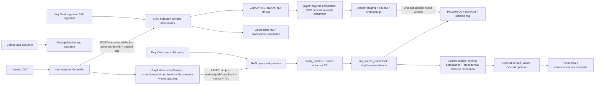

# Arquitectura implementada en el repositorio

Implementación preparada, no desplegada ni migrada sobre datos reales. El corpus anterior sigue intacto. Los resultados de comprobación y los PENDING están en SECURITY_CONTROLS y MIGRATION.

## Cambios y límites concretos

`backend/src/assistant/rag-authorization.service.ts` utiliza JWT.sub únicamente como identidad. Lee usuario actual, rol actual, Estate.administratorId y memberships linked/no revoked/property no deleted. Valida la comunidad elegida, calcula propiedades/documentos autorizados y rechaza ingesta para C. Rol A conserva selección de comunidades existentes, pero cada consulta está acotada a una sola comunidad/tenant; sin selección consulta únicamente publicaciones explícitas public. En modo escritura (`write=true`), Rol A sin finca recibe además el permiso `rag:publish:public`, que habilita la gestión de documentos globales (`classification=public`, `tenant_id=null`); Roles B y C nunca reciben ese permiso. `AssistantService.deleteRagDocument` consulta Prisma para derivar la finca real del documento antes de construir el contexto firmado; para documentos sin registro Prisma (corpus público global) usa el contexto global de Rol A.

RagAuthorizationModule es compartido por Assistant/Files/Resources, sin dependencia de proveedor/vector/storage. Upload, alta de metadata y descarga de documentos app usan también autorización actual. Download deniega originales sin estateId y exige que el ID de documento esté en la lista actual autorizada; ya no conserva bypass de un rol anterior del JWT. StorageService.assertDocumentKey vincula documents/estateId al registro antes de crear/leer/indexar, y filePath rechaza traversal/directorios hermanos. Formatos/descargas de documentos válidamente asociados se mantienen; originales huérfanos y claves arbitrarias requieren revisión/migración explícita.

`AssistantService.callRag` firma el contexto, método, URL relativa exacta, hash de bytes, timestamp, nonce y correlation_id. No manda la clave ni acepta scope del navegador. `rag/security.py` valida firma en tiempo constante, tipos/UUIDs, permisos, TTL 60 s y binding. Nonce persistido evita replay entre réplicas. Las claves de query e ingestion deben ser distintas. La confianza reside en el backend y los workloads autorizados, nunca en Domo/modelo; un backend comprometido sigue siendo un riesgo de plataforma, no una propiedad resuelta por HMAC.

Transporte interno: envelope JSON `{authorization: token, payload: string}`; firma liga exactamente los bytes UTF-8 de payload, método/path y contexto. Las consultas llevan máximo 2 MB incluyendo scope; no se truncan listas de documentos. Backend GET history sigue siendo GET para navegador, pero el puente usa POST privado para llevar el scope en body. Header firmado sigue compatible para clientes internos pequeños; proporcionar header y envelope a la vez se rechaza.

`rag/migrations/001_authorized_rag.sql` añade esquema independiente `rag` y `002_workload_roles.sql` asigna capacidades. Query no tiene SELECT/UPDATE sobre tablas del corpus: solo funciones scopeadas. `visible_documents` impone tenant, comunidad, publicación public explícita, estado indexed/no deleted, active_version, ACL y, para documentos app, lista autorizada desde Prisma. `eligible AS MATERIALIZED` aplica esos controles antes de similitud/RRF, y comprueba coherencia scope/clasificación entre chunk/documento/versión. La capa HTTP valida el contexto firmado antes de llamar al repository. Las funciones DB confían en el servicio autorizado, no verifican JWT de usuario final.

Originales RAG se escriben byte a byte en Blob raw. `storage.py` deriva paths de UUIDs/version/nombre sanitizado, valida paths de borrado contra metadata y prohíbe URLs públicas/shared keys. LocalStorage es exclusivamente opt-in development. Query no instancia storage ni recibe Blob RBAC. `ingestion.py` conserva estados durables y original/cuarentena; ClamAV exige respuesta limpia exacta. Ausencia de scanner, MIME incorrecto, PDF cifrado, páginas vacías sin OCR o límites excedidos excluyen la versión de retrieval. Páginas fallidas ya no se indexan silenciosamente. OCR tiene interfaz inyectable, sin proveedor inventado: **PENDING** integración.

`repository.activate` valida cobertura/dimensiones, inserta todos los chunks y activa la nueva versión bajo lock en una transacción. Fallo revierte todo; versión anterior permanece activa. Scope tenant/comunidad/documento app es inmutable; mover entre comunidades requiere import explícito con nueva identidad. Cambiar clasificación community/restricted ocurre únicamente al activar versión nueva.

Citas visuales salen del chunk: document_id/title/filename/version/page/section, con IDs S1.. verificados. Procedencia completa incluye todos los documentos que entraron al retrieval/reranker y al historial, aunque el modelo no los cite. Historial solo devuelve asistentes si todas esas versiones siguen activas/autorizadas; se revalida procedencia antes de responder/guardar. El historial legacy sin procedencia no se importa ni se expone. Respuestas basadas en finanzas no se reutilizan como evidencia histórica, evitando cifras revocadas/caducadas. No se borra el histórico legacy.

`providers.py` mantiene OpenAI y permite Azure OpenAI con Entra/DefaultAzureCredential, Key Vault y TLS con raíces de certifi para PostgreSQL. No hay tool calling RAG, SQL generado por LLM ni lectura arbitraria de Blob. Prompts distinguen instrucciones/pregunta/contexto no confiable; esto limita privilegios, no garantiza que el modelo ignore toda instrucción maliciosa.

`minimization.py` elimina patrones reconocibles de IBAN, claves OpenAI, Bearer/JWT y conexiones PostgreSQL antes de embeddings/prompts. Originales siguen exactos en raw; los artefactos derivados son minimizados. Es una protección básica determinista, no DLP general ni anonimización automática de nombres u otros formatos secretos. Clasificación/revisión de documentos sigue siendo necesaria.

`CommunityFinanceService` transmite códigos contables, no etiquetas libres. Excluye grupo 64 de totales y presupuesto; suprime saldo si hay personal para evitar reconstrucción simple por resta. Esa supresión es un cambio de privacidad justificado; las cuentas de la aplicación no se modifican.

## Infraestructura preparada

`infra/main.bicep` opt-in enableRagFoundation=false mantiene el despliegue existente. `infra/rag.bicep` prepara VNet con ocho subredes objetivo, Blob privado, contenedores, dos MI, dos Key Vault privados, PostgreSQL separado con Entra/network privado y vector allowlist, DNS/PE y entorno Container Apps con ILB interno. `rag-workloads.bicep` despliega dos workloads, identidades y AcrPull. Ingress external:true en un entorno internal:true permite tráfico de la VNet, no Internet; DNS privado resuelve el ILB.

No migra automáticamente el backend existente a snet-app ni instala WAF/APIM/Firewall. Peering/rutas/NSG/egress controlado, scanner, modelo Azure, permisos DB Entra, secrets, permisos backend mínimos y validación efectiva Azure: **PENDING**. Azure OpenAI PE es opcional para cuenta existente en el RG; desactivar su acceso público requiere configuración externa revisada. No se afirma que estos controles estén desplegados.
